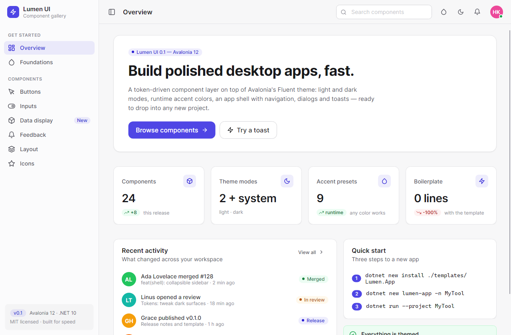
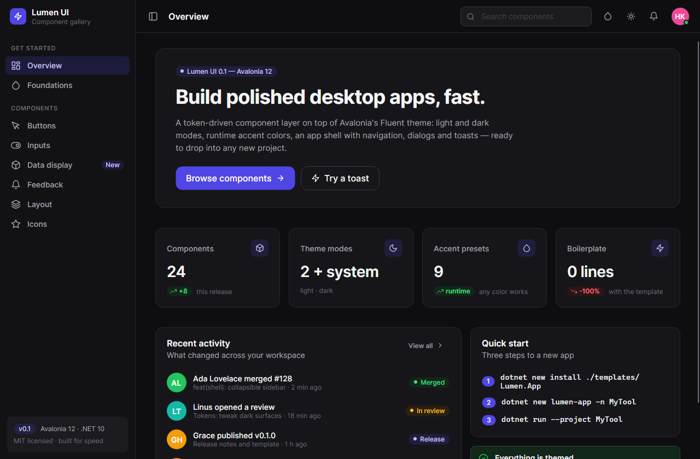
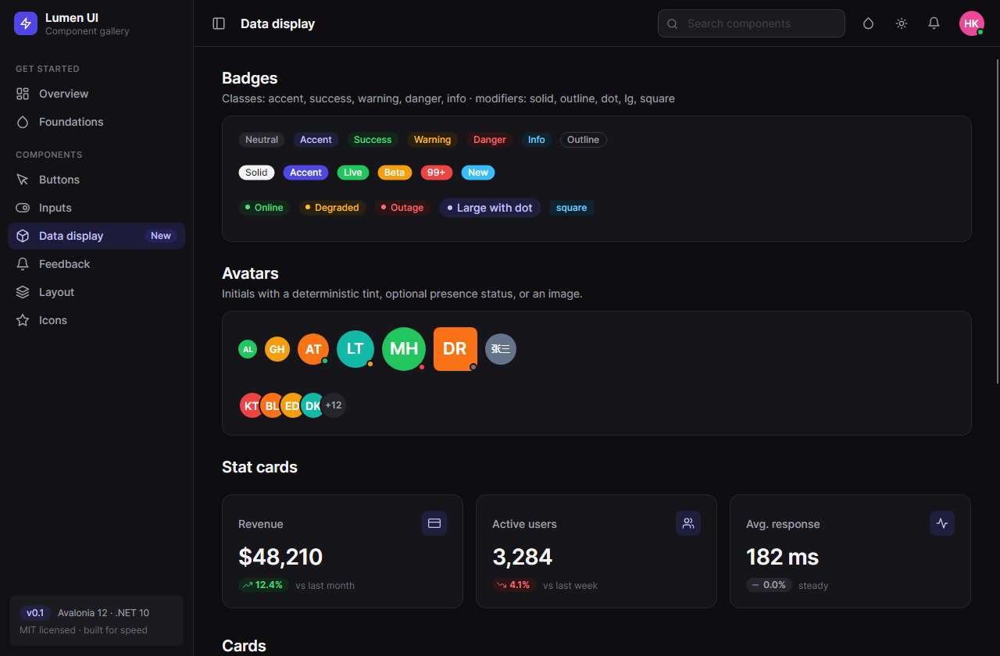
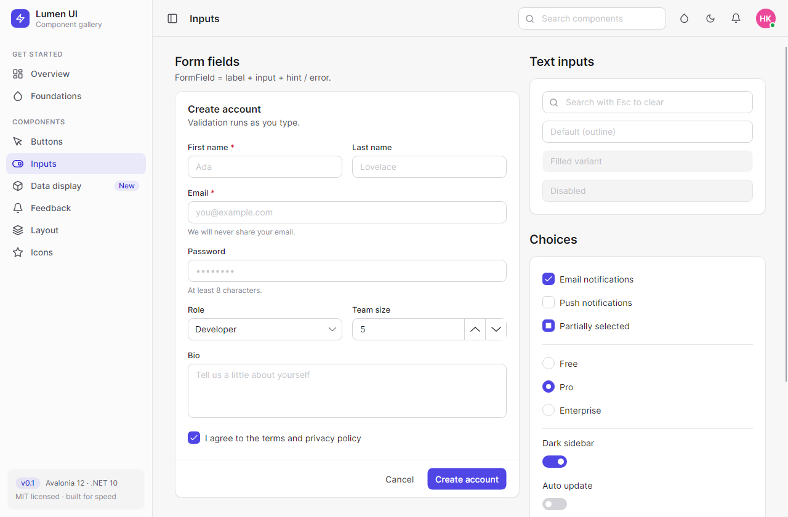
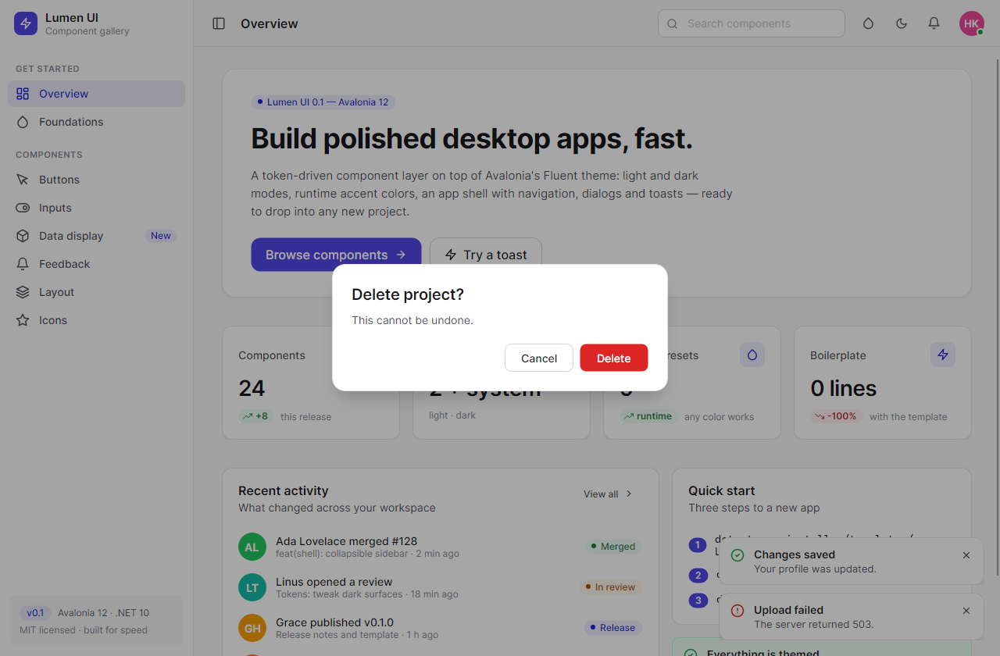

# Lumen.UI

基于 **Avalonia 12 / .NET 10** 的自用现代化组件库。以官方 FluentTheme 为底，叠加一套设计令牌（颜色 / 字体 / 间距 / 圆角 / 阴影）、重绘的内置控件样式和一组常用自定义控件；亮暗双主题，运行时可切换强调色；附带 Gallery 演示和 `dotnet new` 项目模板，新项目一条命令起步。



<table>
  <tr>
    <td></td>
    <td></td>
  </tr>
  <tr>
    <td></td>
    <td></td>
  </tr>
</table>

## 快速开始

### 方式一：用模板新建项目（推荐，任何电脑）

```bash
dotnet new install Lumen.Templates      # 从 nuget.org 安装模板（只需一次）
dotnet new lumen-app -n MyTool
dotnet run --project MyTool/src/MyTool  # 首次编译自动从 nuget.org 下载 Lumen.UI
```

新项目默认用 NuGet 包引用 `Lumen.UI`，版本写在 `MyTool/Directory.Build.props` 的 `LumenUiVersion` 里，升级只改这一处。模板参数：

| 参数 | 默认 | 说明 |
| --- | --- | --- |
| `--LumenSource` | `package` | `package`：引用 nuget.org 上的包；`project`：引用本地源码，适合边改组件库边调试 |
| `--LumenVersion` | 发布时的版本 | package 模式下的 Lumen.UI 版本 |
| `--LumenPath` | `../CSharpGUIFramework/src/Lumen.UI/Lumen.UI.csproj` | project 模式下 `Lumen.UI.csproj` 的路径（相对新解决方案目录或绝对路径） |

```bash
# 引用本机源码（组件库仓库和新项目放在同级目录）
dotnet new lumen-app -n MyTool --LumenSource project
```

更新模板：`dotnet new update`。在本仓库里开发模板时，可以改用 `dotnet new install ./templates/Lumen.App` 直接装文件夹版本。

生成的是一个完整的解决方案脚手架：

```
MyTool/
  MyTool.slnx
  Directory.Build.props      公共编译选项 + Lumen.UI 版本（或源码路径）
  publish.ps1 / publish.sh   一键打包并打印体积
  README.md
  src/MyTool/                LumenTheme、AppShell 导航、CommunityToolkit.Mvvm、
                             Home / Settings 示例页（表单、命令、Toast、确认框、主题与强调色）
    Properties/PublishProfiles/  FrameworkDependent / SelfContained / NativeAot
```

### 打包与体积

```powershell
cd MyTool
./publish.ps1                 # 默认：裁剪后的自包含单文件
./publish.ps1 -Mode aot       # Native AOT
./publish.ps1 -Mode all -Zip  # 三种都打，各生成 zip，并打印体积对比
```

模板应用在 win-x64 上的实测结果：

| 模式 | 产物 | 体积 | zip | 首个窗口出现 |
| --- | --- | --- | --- | --- |
| `fd` 依赖框架 | 1 个 exe（目标机需装 .NET 10） | 29.1 MB | 11.6 MB | ~1.0 s |
| `trimmed` 自包含 + 裁剪 + 压缩 | 1 个 exe，免安装 | 20.5 MB | 15.4 MB | ~1.2 s |
| `aot` Native AOT | exe + 3 个 Skia/HarfBuzz/ANGLE 原生库，免安装 | 34.0 MB | 14.6 MB | ~0.3 s |

发布配置会去掉调试符号（SkiaSharp / HarfBuzz 自带约 100 MB 的原生 .pdb）和桌面应用用不到的运行时功能。Lumen.UI 和模板项目都开启了 `IsAotCompatible`，平时编译就会报出不能裁剪的写法；当前 0 警告。Native AOT 需要 VS Build Tools 的“使用 C++ 的桌面开发”，且只能打本机系统的包；脚本会自动把 `vswhere.exe` 所在目录加入 PATH。更多可选的压缩开关见生成项目里的 README。

### 方式二：接入已有项目

1. `dotnet add package Lumen.UI`（或引用本地源码 `src/Lumen.UI/Lumen.UI.csproj`）。
2. `Program.cs`：

   ```csharp
   AppBuilder.Configure<App>()
       .UsePlatformDetect()
       .UseLumen()          // 注册 Inter 字体
       .LogToTrace();
   ```

3. `App.axaml` 用 `LumenTheme` 替换 `FluentTheme`：

   ```xml
   <Application xmlns:l="https://github.com/HinaKalo/lumen" ...>
     <Application.Styles>
       <l:LumenTheme />
     </Application.Styles>
   </Application>
   ```

所有类型（控件、图标、服务）都在同一个 XAML 命名空间 `https://github.com/HinaKalo/lumen` 下。

## 组件

| 分类 | 组件 |
| --- | --- |
| 布局 | `AppShell`（可折叠侧边栏、顶栏、页面切换、内置 Dialog/Toast 宿主）、`NavItem`、`Card`、`SectionHeader` |
| 展示 | `Icon`（65 个线性图标）、`Badge`、`Avatar`、`StatCard`、`EmptyState`、`Skeleton`、`Spinner` |
| 输入 | `FormField`（标签 + 提示 + 校验错误）、`SearchBox`、`SegmentedControl`、`ThemeToggleButton` |
| 反馈 | `InfoBar`、`Toast` / `ToastHost`、`Dialog` / `DialogHost` |
| 内置控件重绘 | Button / ToggleButton（全新模板）、TextBox、ComboBox、CheckBox、RadioButton、ToggleSwitch、Slider、ProgressBar、ListBox、TabControl、ToolTip、Menu / Flyout |

### 按钮变体

```xml
<Button Classes="primary" Content="Save" />
<Button Classes="soft | outline | ghost | danger | danger-soft | link" />
<Button Classes="sm | lg" />            <!-- 尺寸 -->
<Button Classes="icon ghost"><l:Icon Kind="Settings" /></Button>
<Button Classes="pill" />  <Button Classes="block" />
```

### 文字层级

```xml
<TextBlock Classes="display | headline | title | subtitle | body | caption | overline" />
<TextBlock Classes="body secondary" />  <!-- 修饰：primary secondary tertiary accent success warning danger strong medium mono -->
```

### 反馈：Toast 与对话框

```csharp
Toast.Success("已保存", "设置已更新");
Toast.Error("上传失败", "服务器返回 503");

if (await Dialog.ConfirmAsync("删除项目？", "此操作不可撤销。", "删除", isDanger: true))
{
    // ...
}

var result = await Dialog.ShowAsync(myCustomControl);   // 任意控件当对话框，Dialog.Close(control, value) 返回结果
```

`AppShell` 自带 `DialogHost` 和 `ToastHost`；不使用 `AppShell` 时，把窗口内容包进 `<l:DialogHost>` 并放一个 `<l:ToastHost />` 即可。

### 导航壳

```csharp
public IReadOnlyList<NavItem> NavItems { get; } =
[
    NavItem.Header("WORKSPACE"),
    new("Home", IconKind.Home, () => new HomePage { DataContext = new HomeViewModel() }),
    new("Inbox", IconKind.Inbox, () => new InboxPage()) { Badge = "3" },
];
```

```xml
<l:AppShell Title="My app" NavItems="{Binding NavItems}">
  <l:AppShell.HeaderActions>
    <l:ThemeToggleButton />
  </l:AppShell.HeaderActions>
</l:AppShell>
```

页面首次选中时创建并缓存；`shell.Navigate("Home")` 按标题或 `Tag` 跳转。

## 主题与设计令牌

```csharp
ThemeManager.SetMode(ThemeMode.Dark);          // System / Light / Dark
ThemeManager.Toggle();
ThemeManager.SetAccent(Color.Parse("#0D9488")); // 任意颜色，全局即时生效
ThemeManager.AccentPresets                      // 9 个预设
```

在 XAML 中总是用 `DynamicResource` 引用令牌，切换主题和强调色时自动更新：

| 令牌 | 说明 |
| --- | --- |
| `Lumen.Brush.Background / Surface / SurfaceElevated / SurfaceSubtle / SurfaceHover / Sidebar` | 背景与表面 |
| `Lumen.Brush.Border / BorderSubtle / BorderStrong` | 边框 |
| `Lumen.Brush.TextPrimary / TextSecondary / TextTertiary / TextDisabled` | 文字 |
| `Lumen.Brush.Accent / AccentHover / AccentSubtle / AccentText` | 强调色（跟随 `SetAccent`） |
| `Lumen.Brush.{Success,Warning,Danger,Info}` + `Subtle` / `Text` / `Border` | 状态色 |
| `Lumen.Radius.{Xs,Sm,Md,Lg,Xl,Full}` | 圆角 4 / 6 / 8 / 12 / 16 / 圆 |
| `Lumen.Shadow.{Xs,Sm,Md,Lg}` | 阴影（亮暗分别调校） |
| `Lumen.FontSize.{Caption,Body,Subtitle,Title,Headline,Display}` | 12 / 14 / 16 / 20 / 28 / 36 |
| `Lumen.Height.{Sm,Md,Lg}` | 控件高度 28 / 36 / 44 |

令牌定义在 [`src/Lumen.UI/Tokens`](src/Lumen.UI/Tokens)。Fluent 自带控件通过同目录下的 "Fluent bridge" 映射到这些令牌，所以未重绘的 Fluent 控件也会跟随 Lumen 配色。

### 图标

```xml
<l:Icon Kind="Search" Size="16" />
<l:Icon Data="M4 12 H20" />                 <!-- 任意 24×24 路径 -->
```

```csharp
LumenIcons.Register("rocket", "M4.5 16.5 ...");  // 之后 <l:Icon NameKey="rocket" />
```

图标形状源自 [Lucide](https://lucide.dev) / [Feather](https://feathericons.com)（ISC / MIT）。

## 项目结构

```
src/Lumen.UI/           组件库
  Tokens/               设计令牌（Foundation / Light / Dark + Fluent bridge）
  Themes/               自定义控件与 Button 的 ControlTheme
  Styles/               排版与内置控件样式微调
  Controls/  Icons/  Services/
samples/Lumen.Gallery/  组件演示程序
templates/Lumen.App/    dotnet new 模板（lumen-app）：解决方案脚手架 + 三种发布配置 + 打包脚本
tests/Lumen.UI.Tests/   Avalonia.Headless 测试：主题切换、强调色、每个 Gallery 页面亮/暗渲染
```

## 开发

```bash
dotnet build CSharpGUIFramework.slnx
dotnet run --project samples/Lumen.Gallery
dotnet test
```

测试会把每个 Gallery 页面的亮/暗截图写到测试输出目录下的 `snapshots/`（或环境变量 `LUMEN_SNAPSHOT_DIR` 指定的目录），方便肉眼回归检查；CI 会把它们作为构建产物上传。

## 发布新版本

推送 `v` 开头的标签即可：GitHub Actions（[release.yml](.github/workflows/release.yml)）会编译、测试，把 `Lumen.UI` 和 `Lumen.Templates` 打包，先用打出来的包生成一个模板项目验证能编译，然后推送到 nuget.org，并创建带 `.nupkg` 附件的 GitHub Release。模板里的默认 `LumenVersion` 会自动设成标签版本。

```bash
git tag v0.2.0
git push origin v0.2.0
```

发布走 nuget.org 的 Trusted Publishing：GitHub Actions 用 OIDC 身份换取一次性的短期 Key，仓库里不保存任何 API Key。一次性配置：

1. nuget.org → 用户菜单 → Trusted Publishing → Create：Repository Owner `HinaKalo`，Repository `CSharpGUIFramework`，Workflow File `release.yml`，Environment 留空。
2. 仓库变量 `NUGET_USER` 设为 nuget.org 用户名（不是邮箱）：`gh variable set NUGET_USER --body <用户名>`。

nuget.org 上发布后的版本无法删除，只能下架（unlist），所以同一个版本号只能用一次。

本地打包：

```bash
dotnet pack src/Lumen.UI -c Release -o artifacts/packages
dotnet pack templates/Lumen.Templates.csproj -c Release -o artifacts/packages
```

## License

MIT
